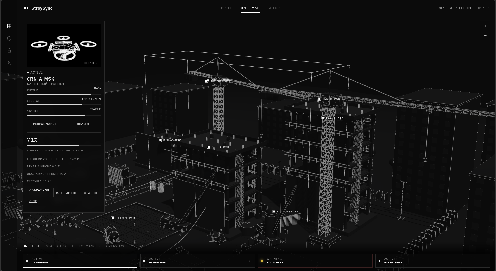
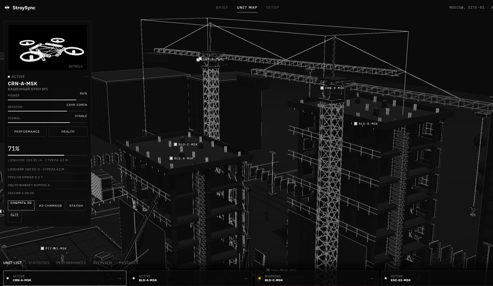
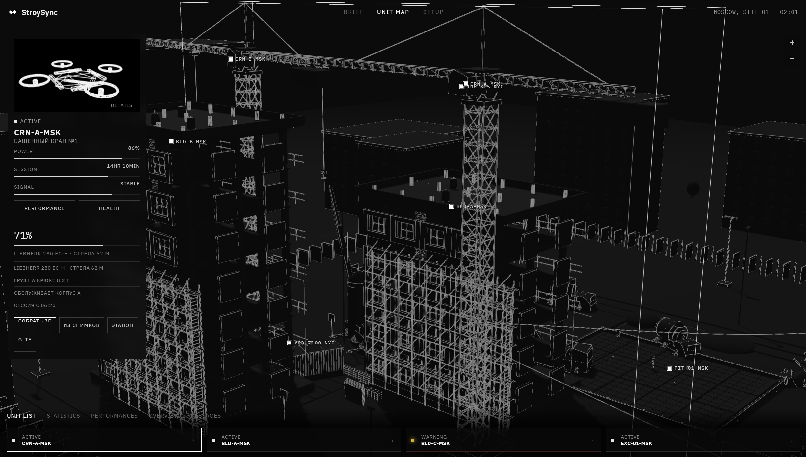

# StroySync

Система наблюдения за стройкой. Кадр с площадки, календарный график и трёхмерная карта участка собираются в одно рабочее место: видно, какая техника на месте, какой этап идёт и где корпус уже расходится с планом.

**StroySync** watches a construction site. A camera frame, the calendar schedule, and a 3D map of the plot stay in one place: which machines are there, which stage is active, and which building has slipped.

## Зачем это нужно

На площадке график живёт в таблице, техника — в кадре камеры, а состояние корпусов — в голове прораба. StroySync связывает эти три слоя. Снимок не остаётся «просто детекцией». Он проходит через зону камеры, активный этап WBS и допустимый состав машин. На выходе статус и правило, по которому этот статус получен.

## Что умеет

- **Кадр и техника.** На снимке находятся самосвал, экскаватор, каток, кран-манипулятор, бетоносмеситель, бульдозер, грузовик и автокран.
- **Связь с графиком.** Камера привязана к зоне и к этапу WBS. Состав машин сравнивается с тем, что для этого этапа допустимо.
- **Понятный статус.** В графике, отклонение или критично. Рядом правило, этап и то, что система увидела на кадре.
- **Карта участка.** Трёхмерная площадка SITE-01: корпуса, краны, котлован, техника. У выбранного объекта открывается карточка: питание, сессия, сигнал, состояние.
- **Сборка сцены.** Карту можно собрать из снимков и выгрузить в GLTF.
- **Журнал площадки.** Заметки по корпусам, технике и смене лежат в хранилище Obsidian и читаются тем же сервисом.
- **Демо без весов.** Готовые сцены прогоняются сразу. Своё фото загружается отдельно, камера выбирается вручную.

## Как кадр становится предупреждением

```text
снимок камеры
    │
    ▼
детектор техники
    │
    ├── календарный график ──► сравнение с typical_signature этапа
    └── камера.linked_wbs
                │
                ▼
     в графике / отклонение / критично
     + правило, этап WBS и состав кадра
```

Сравнение идёт по пересечению множеств: что видно на кадре и какой состав машин записан за этапом. Поэтому предупреждение можно открыть и проверить, а не только увидеть рамку.

Детектор подключается в одном из режимов. По умолчанию это demo: стабильные рамки по имени сцены, без скачивания весов. `world` поднимает YOLO-World и ищет восемь классов по текстовым подсказкам. `coco` берёт YOLOv8n и грубо переводит классы COCO в технику. `auto` идёт по цепочке world, затем coco, затем demo.

Модель не дообучалась на закрытой разметке площадки. Стоит открытая модель и явная база правил. Своя разметка — отдельный следующий шаг, он описан в `docs/`.

## Карта участка

Карта — не иллюстрация к отчёту. Это тот же участок, по которому ходят камеры и график: корпуса A, B и C, краны, котлован, экскаватор. Выбор объекта открывает карточку слева. Снизу остаётся список юнитов и их статус.

Общий вид площадки: корпуса, краны и котлован.



Корпуса крупно: этажи, кран CRN-A-MSK и метки BLD.



Кран вблизи и решётка корпуса.



## Как это собрано

Браузер открывает дашборд. Тот же процесс FastAPI отдаёт и страницу, и API. React-интерфейс — отдельный контур на Vite: он проксирует `/api` на backend. Календарь, камеры и разбор кадров лежат в SQLite, в Docker их можно перенести на PostgreSQL. Заметки остаются markdown-хранилищем Obsidian. Трёхмерная карта собирается в браузере и умеет выгружаться в GLTF.

```text
браузер
    │
    ├── дашборд (HTML, CSS, JavaScript) ──► FastAPI :8000
    └── React / Vite :5173 ──proxy /api──► FastAPI :8000
                │
                ├── SQLAlchemy ── SQLite или PostgreSQL
                ├── детектор: demo | YOLO-World | YOLOv8
                ├── график WBS (CSV / XLSX)
                ├── Obsidian vault, markdown
                └── 3D-карта участка, GLTF
```

## Языки и технологии

Код разделён по языкам. Каждый слой делает свою работу и не смешивается с соседним.

| Язык | Где лежит | Зачем |
| --- | --- | --- |
| Python 3 | `backend/app`, `scripts`, `tools/site_dcc` | API, модели данных, детектор, сравнение с графиком, сборка документации и сэмплов |
| SQL | SQLite локально, PostgreSQL в Docker | Камеры, этапы, разборы кадров. Доступ через SQLAlchemy, без ручных строк в обработчиках |
| JavaScript | `backend/app/static`, `frontend/src` | Дашборд, карта участка, заметки, клиент React |
| JSX | `frontend/src` | Экраны React-интерфейса |
| HTML | `backend/app/static/index.html`, `frontend/index.html` | Каркас дашборда и точка входа Vite |
| CSS | `backend/app/static/app.css`, `frontend/src/index.css` | Тёмная рабочая сцена, карточки юнитов, панели |
| GLSL | `tools/site_dcc/shaders/triplanar.glsl` | Шейдер трипланарной укладки материалов площадки |
| HLSL | `tools/site_dcc/shaders/SiteMaster.usf` | Тот же материал для Unreal |
| Markdown | `HACAOBS/`, `docs/` | Журнал площадки, корпус, техника, смена, описание модели данных |
| YAML | `docker-compose.yml` | Подъём backend, frontend и базы одной командой |
| JSON | конфиги фронтенда, материалы DCC | Зависимости npm и описание материалов сцены |
| PowerShell и Batch | `start-backend.bat`, `start-frontend.bat` | Локальный запуск на Windows |

Вокруг языков стоят библиотеки, а не второй стек.

- **Python.** FastAPI, Pydantic, SQLAlchemy, Uvicorn, Pillow, OpenCV, NumPy, openpyxl, pytest. Полный детектор дополнительно ставит Ultralytics: YOLO-World или YOLOv8.
- **JavaScript.** React 18 и Vite 5 для отдельного интерфейса. Дашборд на `localhost:8000` написан на обычном JavaScript, без сборки.
- **Данные.** CSV и XLSX для календарного графика. GLTF для выгрузки трёхмерной сцены.
- **Поставка.** Docker Compose. Контейнер backend по умолчанию стартует в режиме `demo`, без скачивания весов.

## Запуск

Нужны Python 3.11+ и Node.js 20+. Команды запускаются из корня репозитория.

```powershell
python -m venv .venv
.\.venv\Scripts\Activate.ps1
pip install -r backend\requirements.txt
python scripts\generate_samples.py
$env:PYTHONPATH = "$pwd\backend"
$env:DETECTOR_BACKEND = "demo"
uvicorn app.main:app --app-dir backend --reload --port 8000
```

Дашборд и API открываются на `http://localhost:8000`. Описание API: `http://localhost:8000/docs`.

Отдельный React-интерфейс:

```powershell
cd frontend
npm install
npm run dev
```

Он открывается на `http://localhost:5173` и проксирует `/api` на backend.

Один кадр из командной строки:

```powershell
$env:PYTHONPATH = "$pwd\backend"
python -m app.cli analyze data\samples\sample_foundation.jpg --camera CAM-01 --at 2026-09-17T10:15:00
```

Проверка логики сравнения с графиком:

```powershell
cd backend
pytest -q
```

Docker поднимает весь контур:

```powershell
docker compose up --build
```

Интерфейс: `http://localhost:8080`. API: `http://localhost:8000/docs`.

Чтобы включить YOLO-World, задайте `DETECTOR_BACKEND=world` (или `auto`) у сервиса `backend` в `docker-compose.yml` и пересоберите контейнер.

Ключи и локальные адреса задаются в `.env`. В репозиторий этот файл не входит. Образец полей лежит в `.env.example`.

## Структура

```text
backend/app/      API, модели, детектор, сравнение с графиком, дашборд
frontend/         React-интерфейс
data/schedule/    календарный график, CSV и XLSX
data/samples/     готовые кадры для демо
HACAOBS/          журнал площадки в markdown
tools/site_dcc/   материалы и шейдеры участка
docs/             описание модели данных и снимки интерфейса
scripts/          генерация сэмплов и документов
```
